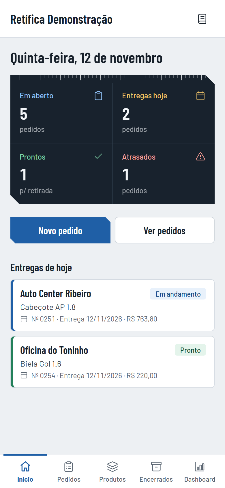
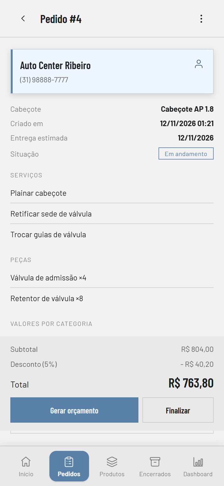
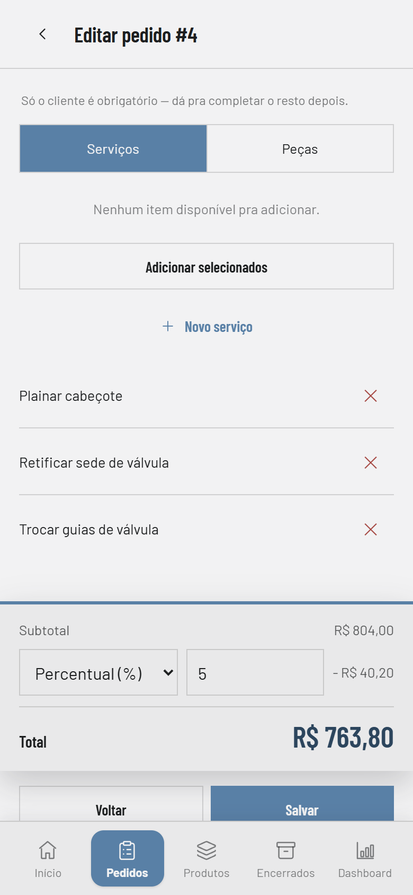
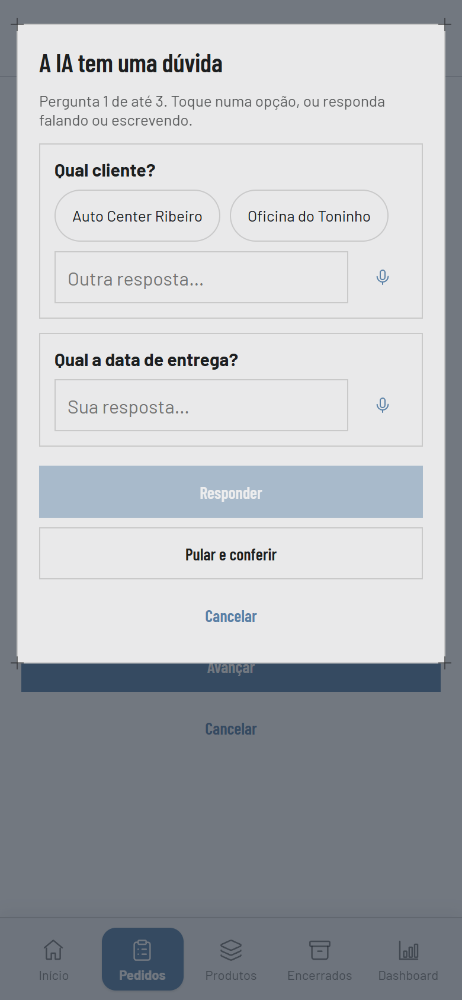
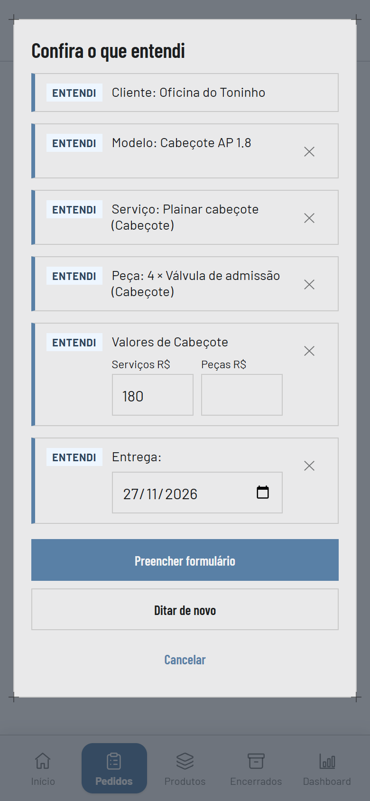
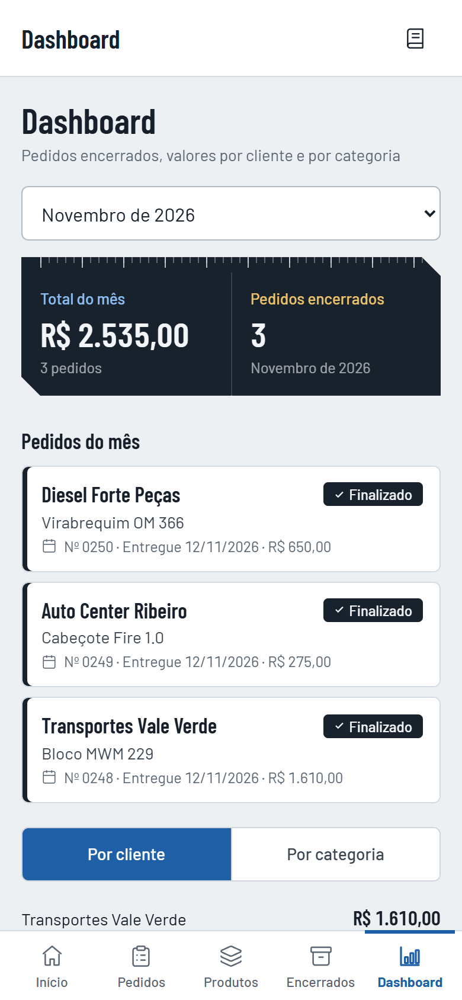
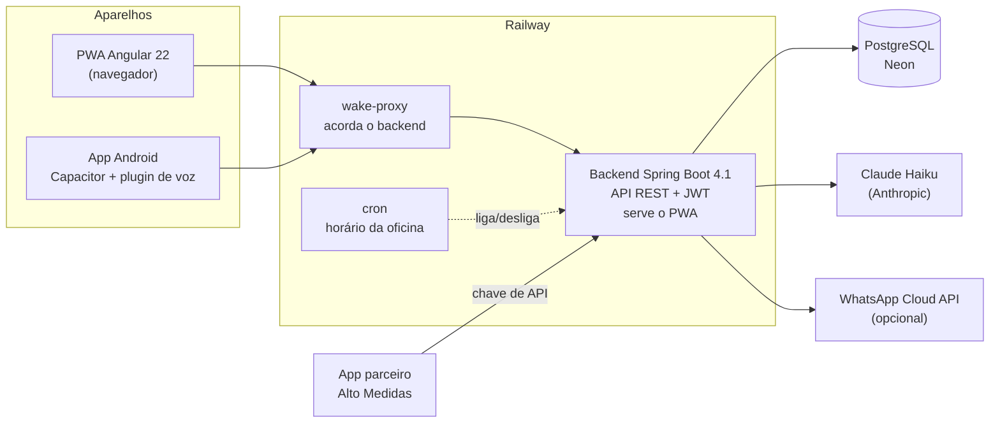

# Retífica: gestão de pedidos para retíficas de motores

Sistema web e mobile usado **em produção, todos os dias**, pela Retífica Dih Soluções para controlar pedidos de serviço: cadastro do pedido no balcão, orçamento em PDF enviado pelo WhatsApp, acompanhamento das entregas e faturamento do mês. Foi pensado desde o início para virar um SaaS multiempresa.


> **English summary** at the [end of this page](#english-summary).

## O que o sistema faz

| Início | Pedido | Itens e total |
|:---:|:---:|:---:|
|  |  |  |
| **Ditado com IA: a dúvida** | **Ditado com IA: a conferência** | **Dashboard do mês** |
|  |  |  |

<sub>Capturas feitas com dados fictícios, num ambiente local.</sub>

- **Pedidos**: cliente, componentes do motor, serviços e peças por categoria, desconto, prazo e situação. O formulário guarda rascunho no aparelho e avisa antes de perder dados.
- **Orçamento em PDF** gerado no servidor, compartilhado direto do celular (Web Share API). A foto do componente entra como última página do próprio PDF, montada no aparelho.
- **Ditar o pedido por voz**: a pessoa fala o pedido, uma IA entende, **pergunta o que ficou ambíguo** e mostra uma conferência antes de preencher o formulário. Nada é salvo sem confirmação.
- **Dashboard** do mês por cliente e por categoria, e histórico de pedidos encerrados.
- **Integração com um app parceiro** (Alto Medidas) para serviços de virabrequim terceirizados, com controle do que já foi pago e repassado.
- **Instalável**: PWA no navegador e app Android (Capacitor) com reconhecimento de voz nativo.

## Destaques técnicos

**Multiempresa com isolamento testado.** Cada requisição carrega no JWT a empresa do usuário, e toda consulta filtra por ela. Um teste de matriz falha se surgir um endpoint sem classificação de proteção, e outro tenta ler, alterar e apagar dados de uma empresa usando o token de outra. ([docs/SAAS.md](docs/SAAS.md), [docs/ARQUITETURA.md](docs/ARQUITETURA.md#autenticação-e-isolamento-por-empresa))

**IA com rédea curta.** O ditado usa o Claude Haiku pelo SDK oficial em Java. A IA recebe o catálogo da empresa e devolve só referências a ele. O backend valida cada ID que volta contra o banco (`NormalizadorDitado`) e descarta o que não existe. A IA nunca salva nada nem sobrescreve o que a pessoa já preencheu: diferenças viram conflitos na tela de conferência. Há limite de uso por empresa e global, e cache de prompt para baratear. ([backend/DITADO.md](backend/DITADO.md))

**Migração de front sem parar a oficina.** O front era um único `app.js` em JavaScript puro. Foi reescrito em Angular 22 (standalone, zoneless, signals) em seis fases, com o app novo rodando em paralelo em `/novo/` até ser aprovado no celular. Na troca, um service worker de transição migra sozinho os aparelhos que tinham o app antigo em cache. O roteiro foi testado contra o worker antigo instalado e pegou um travamento antes de chegar aos usuários. ([frontend/README.md](frontend/README.md), [docs/LICOES.md](docs/LICOES.md))

**Voz nativa no Android.** No navegador, o reconhecimento de voz do Android corta palavras ao reiniciar. O APK em Capacitor traz um plugin Java com o `SpeechRecognizer` em sessão segmentada (Android 13+). O mesmo front detecta o plugin e troca de motor sem mudar a interface. ([android-app/LEIA-ME.md](android-app/LEIA-ME.md))

**Infraestrutura enxuta.** Backend no Railway com Postgres gerenciado no Neon. Um cron liga e desliga o backend no horário da oficina, e um proxy pequeno o acorda sob demanda fora do horário. A imagem Docker é multi-estágio (Node para o front, Maven para o backend, JRE enxuta no final). ([docs/PRODUCAO.md](docs/PRODUCAO.md))

**Testes que protegem dados reais.** Os testes de integração sobem o Spring contra um Postgres descartável e **abortam se o ambiente apontar para outro banco**. Integrações externas (IA e WhatsApp) são testadas contra servidores falsos locais. Regras de negócio valem no servidor, não só na tela: pedido finalizado, por exemplo, não aceita edição pela API (409), com a linha travada no banco para um "finalizar" simultâneo não escapar. ([backend/TESTES.md](backend/TESTES.md))

## Arquitetura



| Camada | Tecnologia |
|---|---|
| Front-end | Angular 22 (standalone, zoneless, signals), service worker do Angular, Vitest |
| Mobile | PWA instalável e app Android com Capacitor 7 (plugin nativo em Java) |
| Back-end | Java 21, Spring Boot 4.1, Spring Security com JWT (jjwt), SDK Java da Anthropic |
| Dados | JPA/Hibernate 7, PostgreSQL 16 (Neon em produção, Docker localmente) |
| Documentos | PDF do orçamento com OpenPDF no servidor; pdf-lib no aparelho para anexar a foto |
| Infra | Docker multi-estágio, Railway (backend, proxy e cron), GitHub |

## Como o projeto é organizado

Maven multi-módulo (Java 21) e um projeto Angular:

| Pasta | O que é |
|---|---|
| `core/` | Entidades JPA, persistência e geração do PDF. Sem interface. |
| `backend/` | API REST em Spring Boot. Também serve o build do front. É o que roda em produção. |
| `frontend/` | O PWA em Angular 22. |
| `android-app/` | App Android (Capacitor) com o plugin nativo de voz. |
| `railway-wake-proxy/`, `railway-cron/` | Proxy que acorda o backend e o agendamento de liga/desliga. |
| `desktop/` | App JavaFX original, de antes da versão web. Fora do build ([por quê](docs/ARQUITETURA.md#desktop-javafx)). |

## Rodando localmente

Requisitos: JDK 21 ou mais novo, Maven, Docker e Node.js 22.

```bash
docker compose up -d                                  # Postgres local (porta 5432)
(cd frontend && npm ci && npm run build:backend)      # compila o front e copia para o backend servir
mvn -pl core,backend -am -DskipTests package
SSL_ENABLED=false java -jar backend/target/retificas-backend.jar
```

O app abre em `http://localhost:8443`. Para trabalhar só no front com recarga automática, rode `npm start` dentro de `frontend/` (usa o backend local). O passo a passo completo, com HTTPS local e acesso pelo celular, está em [docs/DESENVOLVIMENTO.md](docs/DESENVOLVIMENTO.md).

## Testes

```bash
docker compose -f docker-compose.test.yml up -d --wait   # Postgres descartável em localhost:5544
mvn -pl core,backend -am test                             # 192 testes do backend
docker compose -f docker-compose.test.yml down
(cd frontend && npm test -- --watch=false)                # 623 testes do front
```

O que cada teste garante está em [backend/TESTES.md](backend/TESTES.md).

## Documentação

| Documento | Para quê |
|---|---|
| [docs/ARQUITETURA.md](docs/ARQUITETURA.md) | Módulos, modelo de dados, API, autenticação, isolamento entre empresas e riscos conhecidos. |
| [docs/PWA.md](docs/PWA.md) | O app tela a tela, rascunhos, sessão e service worker. |
| [frontend/README.md](frontend/README.md) | O front em Angular: estrutura, build, testes, service worker e a migração. |
| [backend/DITADO.md](backend/DITADO.md) | O ditado com IA: fluxo, validação, custo, limites e segurança. |
| [backend/TESTES.md](backend/TESTES.md) | Como rodar os testes e o que cada um garante. |
| [docs/SAAS.md](docs/SAAS.md) | Estado do multiempresa e decisões tomadas. |
| [docs/PRODUCAO.md](docs/PRODUCAO.md) | Railway, Neon, variáveis de ambiente e como publicar. |
| [docs/DESENVOLVIMENTO.md](docs/DESENVOLVIMENTO.md) | Rodar, compilar, testar e depurar localmente. |
| [docs/LICOES.md](docs/LICOES.md) | Armadilhas encontradas pelo caminho e como foram resolvidas. |
| [android-app/LEIA-ME.md](android-app/LEIA-ME.md) | Gerar, assinar e instalar o APK. |
| [backend/ALTO-MEDIDAS.md](backend/ALTO-MEDIDAS.md) | Integração com o app parceiro. |
| [backend/WHATSAPP-API.md](backend/WHATSAPP-API.md) | Envio do orçamento pela API oficial do WhatsApp (pronto, desligado). |
| [backend/SCHEMA-STARTUP.md](backend/SCHEMA-STARTUP.md) | Medição do custo do `hbm2ddl` na subida e alternativas. |
| [CONTEXTO.md](CONTEXTO.md) | Estado atual e regras de trabalho, para retomar o projeto. |

## Limitações conhecidas

Registradas de propósito, com o motivo:

- **Login automático ligado.** Hoje só uma empresa usa o sistema, então o app entra sozinho como o usuário dela. A tela de login, o JWT e o isolamento por empresa já existem e estão testados. Para desligar: uma constante no front e a remoção do endpoint de auto-login no backend, com o passo a passo em [docs/SAAS.md](docs/SAAS.md#login-automático).
- **O módulo desktop** (JavaFX) é o app original e não acompanha o modelo atual. Está fora do build.

## Cuidados para quem for mexer

- **Há dados reais em produção.** Nunca rode testes nem scripts contra o banco de produção; use o Postgres local ou o descartável.
- **Nunca coloque segredos no repositório** (ele é público). Tokens, senhas, chaves e URLs de banco ficam só nas variáveis de ambiente do Railway.

## English summary

**Retífica** is a production web and mobile system used daily by an engine machine shop in Brazil to manage service orders: order intake, PDF quotes shared over WhatsApp, delivery tracking and monthly revenue. It is built to become a multi-tenant SaaS.

- **Stack:** Java 21, Spring Boot 4.1 (REST + JWT), Hibernate 7, PostgreSQL (Neon), Angular 22 (standalone, zoneless, signals), Capacitor 7 for Android, Docker, Railway.
- **Multi-tenancy with tested isolation:** the tenant comes from the JWT on every request, and an endpoint-matrix test checks that no data leaks between companies.
- **Voice dictation with an LLM, kept on a short leash:** Claude Haiku turns a spoken order into structured data using only the company's catalog. Every returned ID is validated server-side, the model asks clarifying questions when something is ambiguous, and nothing is saved without human review.
- **Zero-downtime front-end rewrite:** a vanilla JS single-file app was migrated to Angular in six phases, running side by side at `/novo/` until approved on real phones, with a transition service worker that moves cached clients to the new app.
- **Native Android voice plugin** (Java `SpeechRecognizer`, segmented sessions) to fix word cuts in the browser's speech API.
- **Tests:** 192 backend tests against a disposable PostgreSQL (they refuse to run against any other database), fake servers for the AI and WhatsApp APIs, and 623 front-end tests with Vitest.

## Autor

**Miguel Belizario**: [LinkedIn](https://www.linkedin.com/in/miguelbelizario) · [GitHub](https://github.com/dragonger)
